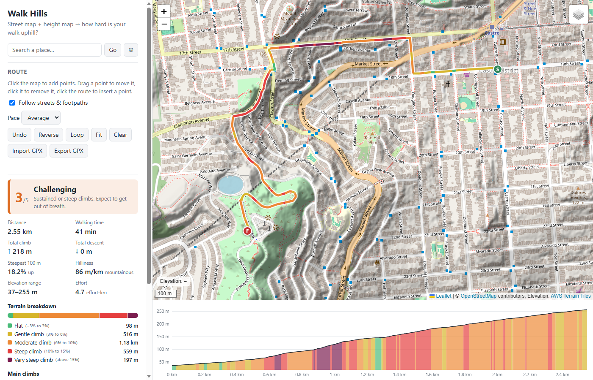

# Walk Hills

A browser app that combines a street map with a height map (terrain elevation) and rates how hard a walk is,
with a focus on the uphill sections.



## Run

It's a static site with no build step and no API keys. ES modules need to be served over HTTP:

```sh
python -m http.server 8000
```

Then open <http://localhost:8000>. `tests.html` runs the unit tests for the analysis code in the browser.

## Use

- **Click the map** to add points. Drag points to move them, click a point to remove it, or click the route to insert a point.
- **Route** style:
  - **Main streets** (default): uses main streets wherever that's at most ~25% (+50 m) longer than the shortest walk,
    and the shortest walk otherwise. It works by routing on the car network with one-way restrictions ignored.
    To divert, add a point on the side street or path you want. A point more than 40 m from a road (e.g. on a park path)
    makes that leg use walking routing.
  - **Flattest**: for each leg, collects ~10–13 candidate routes and picks the one with the gentlest climbing. The candidates
    are walking routes and their alternatives, hill-avoiding bike routes, and routes forced through points to the left and
    right of the direct line (with any out-and-back spurs removed). Each candidate is scored with the terrain model as
    `cost = distance + w × Σ climb × (1 + (grade/10%)²) + w/3 × Σ descent × (1 + (grade/15%)²)`.
    A metre climbed at 30% therefore counts 10× as much as one climbed on the flat. This matters because when the end is
    higher than the start, every route has to climb the same total, so the only real difference is how steep it gets.
    The *Avoid hills* setting picks w (5 / 12 / 30 m of extra walking per weighted metre of climb).
  - **Shortest**: shortest walking route on any street or path. **Straight lines**: no routing.
- **Reverse** walks the route the other way, so you can compare the uphill direction with the downhill one.
- **Import GPX** to rate a recorded or planned track. **Export GPX** saves the route with elevations.
- **Height map overlay**: *Relief* (hillshade), *Slope* (colours steep ground), or *Elevation* (colours stretched to the visible area).
- **Share** gives a link to the route, with buttons to copy it or send it by WhatsApp or email. Opening the link shows the
  same route in the app. The URL hash holds the waypoints and route style, so the route is recalculated when the link is
  opened. Imported GPX tracks are stored in the link too, simplified just enough to keep it under about 1,600 characters.

## How the difficulty is calculated

1. The route is resampled every ~10 m and an elevation is read for each point from the terrain tiles (bilinear interpolation).
2. The elevations are smoothed over about ±25 m. This stops terrain-model noise from inflating the total climb.
3. For each segment it measures the grade over a ±20 m window, then computes total climb and descent,
   distance in each grade band, the steepest 100 m stretch, and the main climbs (rises of at least 10 m, ignoring dips under 5 m).
4. **Walking time** uses [Tobler's hiking function](https://en.wikipedia.org/wiki/Tobler%27s_hiking_function), scaled by the chosen pace.
5. **Level (1–5)**: start from *effort-km* = km + climb(m) / 100, the Swiss "Leistungskilometer"
   - Easy < 4, Moderate < 8, Challenging < 13, Hard < 20, Very hard ≥ 20
   - +1 level for ≥ 150 m of climbing steeper than 10%
   - +1 more if the climb is ≥ 60 m in total and there are ≥ 300 m steeper than 15%, or a 100 m stretch averaging ≥ 20%

All the thresholds are in `js/difficulty.js`.

## Data sources

| What | Source |
|---|---|
| Street maps | OpenStreetMap standard, Humanitarian, and OpenTopoMap tiles |
| Elevation | [AWS Terrain Tiles](https://registry.opendata.aws/terrain-tiles/) (Terrarium PNG, zoom ≤ 15; SRTM, USGS 3DEP, EU-DEM, etc.) |
| Routing | [FOSSGIS OSRM](https://routing.openstreetmap.de/) (foot) and [FOSSGIS Valhalla](https://valhalla1.openstreetmap.de/) (pedestrian, bicycle, auto) |
| Place search | Nominatim |

These are free public services with fair-use policies. For heavy use, host your own OSRM and tiles.

**Accuracy notes:** the elevation model is "bare earth" at roughly 1–30 m resolution depending on the region.
Bridges, tunnels and stairs between buildings can show up as false dips or spikes, and very short, steep ramps
may be smoothed out.

## Code layout

| File | Purpose |
|---|---|
| `js/elevation.js` | Fetch, decode and cache terrain tiles; sample elevations |
| `js/terrain.js` | Leaflet layer that renders relief, slope and elevation from those tiles |
| `js/difficulty.js` | Pure analysis: smoothing, grades, climbs, time, difficulty level |
| `js/routing.js` | OSRM and Valhalla clients (rate-limited) |
| `js/planner.js` | Route modes: main streets, flattest (candidate generation and scoring), shortest |
| `js/profile.js` | Canvas elevation profile chart |
| `js/share.js` | Store a route in the URL, for share links |
| `js/app.js` | UI wiring |
